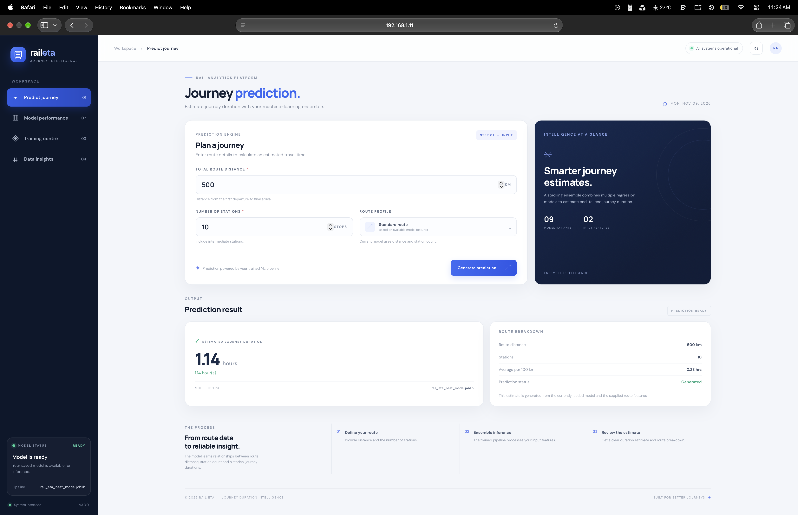
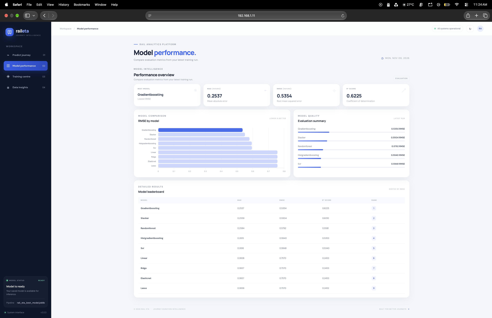
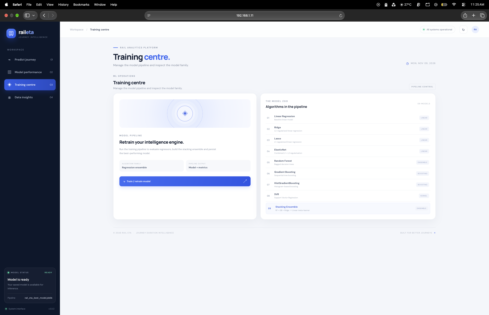
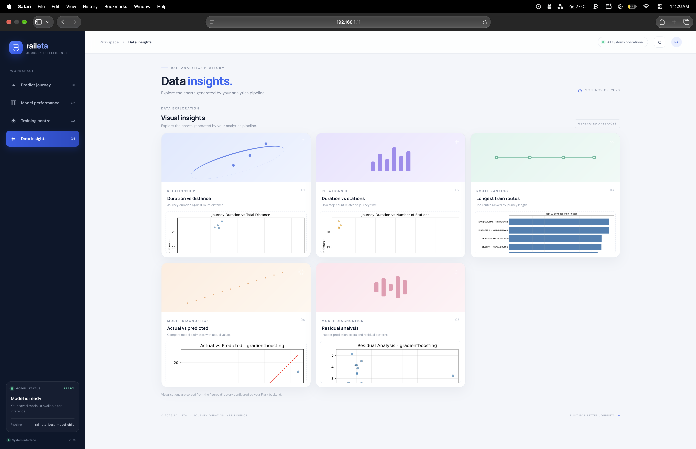

<div align="center">

# 🚄 Rail ETA
### Train Journey Duration Intelligence

**An end-to-end machine learning system for estimating train journey duration.**

Built with Flask, scikit-learn, and a structured model-training pipeline.

[](https://www.python.org/)
[](https://flask.palletsprojects.com/)
[](https://scikit-learn.org/)
[](https://pandas.pydata.org/)
[](LICENSE)
[](Dockerfile)

</div>

---

## Contents

- [Overview](#-overview)
- [Key capabilities](#-key-capabilities)
- [Technology stack](#-technology-stack)
- [System structure](#-system-structure)
- [Installation](#-installation)
- [Quick start](#-quick-start)
- [Using the system](#-using-the-system)
- [Model architecture](#-model-architecture)
- [Methodology](#-methodology)
- [Evaluation](#-evaluation)
- [Visualisations](#-visualisations)
- [Testing and code quality](#-testing-and-code-quality)
- [Deployment](#-deployment)
- [Configuration](#-configuration)
- [Troubleshooting](#-troubleshooting)
- [Contributing](#-contributing)
- [Application preview](#-application-preview)
- [Author](#-author)

---

## 🎯 Overview

**Rail ETA** is an end-to-end machine learning application designed to estimate the total journey duration of a train from two route-level inputs:

| Input | Description |
|---|---|
| **Total distance (km)** | Cumulative distance between the origin and destination |
| **Number of stations** | Total number of stations or stops along the route |

The pipeline accounts for several railway-data considerations:

- **Midnight-crossing journeys** — corrects timestamps when a journey continues past 00:00.
- **Station dwell time** — journey duration reflects the elapsed time across intermediate stops.
- **Train-level aggregation** — consolidates station-level records into train-level route features.
- **Model comparison** — evaluates eight regression algorithms and selects a model using test-set RMSE.
- **Interactive predictions** — serves predictions through a Flask web interface.

The web interface is described as using glassmorphism styling, animated background elements, smooth transitions, and AJAX-powered predictions.

## ✨ Key capabilities

| Area | Capability | Description |
|---|---|---|
| Prediction | Journey-duration estimation | Estimate duration from route distance and station count |
| Web experience | AJAX predictions | Display predictions without a full page reload |
| Regression | Eight candidate models | Compare linear, regularised, tree-based, boosting, and kernel methods |
| Ensemble | Stacking regressor | Combine Random Forest, Gradient Boosting, and Ridge predictions |
| Time processing | Midnight correction | Roll timestamps forward when a journey crosses midnight |
| Evaluation | Regression metrics | Calculate MAE, MSE, RMSE, and R² |
| Visualisation | Diagnostic charts | Generate route, feature, prediction, and residual plots |
| Engineering | CLI and API | Support terminal-based and HTTP-based workflows |
| Delivery | Docker support | Build and run the application in a container |
| Quality | Automated checks | Run tests, linting, and type checking |

## 🧰 Technology stack

| Layer | Technology |
|---|---|
| Language | Python 3.10+ |
| Web framework | Flask 3.1+ |
| Machine learning | scikit-learn 1.3+ |
| Data processing | Pandas 2.0+ |
| Numerical computing | NumPy 1.24+ |
| Model persistence | joblib 1.2+ |
| Configuration | Pydantic Settings 2.0+ |
| Frontend | HTML5, CSS3, Vanilla JavaScript |
| UI styling | Glassmorphism and CSS animations |
| Typography | Inter |
| Testing | pytest, pytest-cov |
| Code quality | Ruff, Black, mypy |
| CI/CD | GitHub Actions |
| Containerisation | Docker, Docker Compose |

## 🗂 System structure

```text
Sysslan_Data_Science_Internship-main/
│
├── flask_app.py                 # Flask application entry point
├── app.py                       # Legacy Streamlit dashboard
├── requirements.txt             # Production dependencies
├── requirements-dev.txt         # Development dependencies
├── pyproject.toml               # Project and lint configuration
├── Makefile                     # Common development commands
├── Dockerfile                   # Container image definition
├── docker-compose.yml           # Container orchestration
├── .env.example                 # Environment variable template
├── .gitignore
├── LICENSE
│
├── src/
│   ├── __init__.py
│   ├── api_main.py               # Flask route definitions
│   ├── base.py                   # Model registry and stacking setup
│   ├── builder.py                # Feature engineering facade
│   ├── cli.py                    # Train and prediction commands
│   ├── config.py                 # Environment-aware configuration
│   ├── data_loader.py            # CSV loading and schema validation
│   ├── exceptions.py             # Custom exception hierarchy
│   ├── logger.py                 # Logging configuration
│   ├── metrics.py                # Regression metric calculation
│   ├── pipeline.py               # Training orchestration
│   ├── predictor.py              # Single and batch predictions
│   ├── training_pipeline.py      # Model training and selection
│   ├── time_utils.py             # Time parsing and midnight correction
│   ├── train_route_analysis.py   # Legacy training script
│   ├── predict_journey.py        # Legacy prediction script
│   └── visuals.py                # Diagnostic charts
│
├── templates/
│   └── index.html                # Flask interface
│
├── static/
│   ├── css/style.css             # UI styling and animations
│   └── js/app.js                 # AJAX and interaction logic
│
├── tests/
│   └── test_core.py
│
├── data/
│   └── Dataset1.csv
│
├── models/                       # Trained artefacts (gitignored)
│   └── rail_eta_best_model.joblib
│
├── results/                      # Metrics and generated figures
│   ├── metrics.json
│   ├── features.csv
│   └── figures/
│
├── docs/
│   ├── ARCHITECTURE.md
│   ├── API.md
│   ├── DEPLOYMENT.md
│   ├── USER_GUIDE.md
│   ├── METHODOLOGY.md
│   └── CONTRIBUTING.md
│
└── .github/workflows/ci.yml
```

## 🚀 Installation

### Prerequisites

- Python 3.10 or later
- pip
- Git
- Docker and Docker Compose (optional)

### 1. Clone the repository

Replace the placeholder with the repository URL you use.

```bash
git clone https://github.com/zainulabedeen589/Rail_ETA.git
cd Rail_ETA-main
```

### 2. Create a virtual environment

```bash
python -m venv .venv
```

**macOS / Linux**

```bash
source .venv/bin/activate
```

**Windows PowerShell**

```powershell
.venv\Scripts\Activate.ps1
```

Verify the active interpreter:

```bash
which python
```

### 3. Install dependencies

```bash
python -m pip install --upgrade pip
pip install -r requirements.txt
```

For development and quality checks:

```bash
pip install -r requirements-dev.txt
```

### 4. Configure environment variables

```bash
cp .env.example .env
```

Update `.env` as required:

```ini
RAIL_ETA_DATA_PATH=data/Dataset1.csv
RAIL_ETA_API_PORT=5001
RAIL_ETA_LOG_LEVEL=INFO
```

## ⚡ Quick start

From the project root, with the virtual environment activated:

```bash
# Train the model pipeline
python -m src.pipeline

# Start the Flask application
python flask_app.py
```

Open the application:

```text
http://localhost:5001
```

## 💻 Using the system

### Flask web application

Start the server:

```bash
python flask_app.py
```

The interface provides:

| Section | Purpose |
|---|---|
| Home / Predict | Enter route distance and station count to estimate journey duration |
| About | Review the system approach, including time correction and model methodology |

**Prediction workflow**

1. Enter the total route distance in kilometres.
2. Enter the number of stations or stops.
3. Select **Predict Duration**.
4. Review the predicted duration in hours and its human-readable representation.

### Command-line interface

Train the model:

```bash
PYTHONPATH=src python -m pipeline
```

Run a single prediction:

```bash
PYTHONPATH=src python -m cli predict --distance 500 --stations 10
```

Run batch predictions:

```bash
# Input CSV columns: Total_Distance, Number_of_Stations
PYTHONPATH=src python -m cli predict-batch \
  --input routes.csv \
  --output predictions.csv
```

Example output:

```text
1.14 hour(s)
```

### Python API

The project exposes prediction helpers through its Python modules. The following example reflects the module interface documented for this project; verify import paths against the checked-out source before using it in another package.

```python
import sys
from pathlib import Path

# Add src/ to the Python path
sys.path.insert(0, str(Path(__file__).resolve().parent / "src"))

from config import settings
from predictor import load_model, predict_single, format_duration

# Load the trained model
model = load_model(settings.model_path)

# Single prediction
hours = predict_single(model, distance=500.0, stations=10)

print(f"Predicted: {hours:.2f} hours")
print(f"Human-readable: {format_duration(hours)}")
```

### REST API

The Flask service documents the following endpoints.

#### `GET /health`

Health-check endpoint:

```bash
curl http://localhost:5001/health
```

Example response:

```json
{
  "status": "ok",
  "service": "rail-eta",
  "version": "3.0.0"
}
```

#### `POST /api/predict`

Predict journey duration for one route:

```bash
curl -X POST http://localhost:5001/api/predict \
  -H "Content-Type: application/json" \
  -d '{"distance": 500, "stations": 10}'
```

Request fields:

| Field | Type | Required | Description |
|---|---|---|---|
| `distance` | float | Yes | Total route distance in kilometres |
| `stations` | int | Yes | Number of stations or stops |

Example response:

```json
{
  "distance": 500.0,
  "stations": 10,
  "predicted_duration_hours": 1.1377,
  "predicted_duration_human": "1.14 hour(s)"
}
```

#### `GET /api/metrics`

Retrieve model evaluation metrics:

```bash
curl http://localhost:5001/api/metrics
```

For the authoritative request and response contract, refer to [`docs/API.md`](docs/API.md).

## 🧠 Model architecture

Rail ETA compares eight regression algorithms and selects the best-performing candidate using RMSE on a held-out test set.

### Candidate models

| Model | Family | Tuned parameters documented |
|---|---|---|
| Linear Regression | Linear | — |
| Ridge | Linear, L2 regularisation | `alpha` |
| Lasso | Linear, L1 regularisation | `alpha` |
| ElasticNet | Linear, L1 + L2 regularisation | `alpha`, `l1_ratio` |
| Random Forest | Bagging ensemble | `n_estimators`, `max_depth`, `min_samples_split` |
| Gradient Boosting | Boosting ensemble | `n_estimators`, `learning_rate`, `max_depth` |
| HistGradientBoosting | Boosting ensemble | `max_iter`, `learning_rate`, `max_depth` |
| SVR | Kernel-based | `C`, `gamma` |

### Stacking ensemble

The documented stacking configuration combines three base estimators with a Linear Regression meta-learner:

```text
                  Input features
                        │
          ┌─────────────┼─────────────┐
          ▼             ▼             ▼
     Random Forest  Gradient       Ridge
                    Boosting
          └─────────────┼─────────────┘
                        ▼
              Linear Regression
                (meta-learner)
                        │
                        ▼
                Final prediction
```

The ensemble uses scikit-learn's `StackingRegressor`.

### Model selection and persistence

- Test split: 20% hold-out.
- Random state: `42`.
- Selection criterion: lowest test-set RMSE.
- Persisted artefact: `models/rail_eta_best_model.joblib`.
- The saved pipeline contains the `StandardScaler` preprocessor and the selected regressor.
- Model persistence uses `joblib`.

## 🔬 Methodology

### End-to-end data pipeline

```text
Raw CSV
   │
   ▼
Schema validation
   │
   ▼
Time parsing (HH:MM:SS)
   │
   ▼
Midnight-crossing correction
   │
   ▼
Route aggregation (Train_No)
   │
   ▼
Feature engineering
   │
   ▼
Journey-duration target calculation
   │
   ▼
Train / test split (80 / 20)
   │
   ▼
Feature scaling
   │
   ▼
Training and hyperparameter search
   │
   ▼
Stacking ensemble
   │
   ▼
Model selection by RMSE
   │
   ▼
Pipeline serialisation with joblib
```

### Feature engineering

Station-level records are consolidated into one record per train.

| Feature | Derivation | Role |
|---|---|---|
| `Start_Station` | First station by sequence number | Categorical |
| `End_Station` | Last station by sequence number | Categorical |
| `Total_Distance` | Maximum `Distance` value per train | Numeric |
| `Number_of_Stations` | Count of stations per train | Numeric |
| `Journey_Duration_Hours` | First departure to final arrival, in hours | Target |

Rows with missing values or non-positive distance or duration are dropped.

### Midnight-crossing correction

A journey that crosses midnight can appear to have a negative elapsed interval if only clock times are compared. For example, a departure at `23:00` followed by an arrival at `01:00` belongs to the next calendar day.

Rail ETA corrects this by rolling a timestamp forward by 24 hours whenever it is earlier than the previous timestamp. This maintains a monotonically non-decreasing timeline before journey duration is calculated.

## 📈 Evaluation

The project reports four regression metrics:

| Metric | Interpretation | Preferred direction |
|---|---|---|
| MAE | Average absolute prediction error, in hours | Lower |
| MSE | Mean squared prediction error; larger errors receive more weight | Lower |
| RMSE | Square root of MSE, expressed in hours | Lower |
| R² | Proportion of target variance explained by the model | Higher |

Metrics are computed on the test split and written to `results/metrics.json`.

### Documented sample results

| Model | MAE (hours) | RMSE (hours) | R² |
|---|---:|---:|---:|
| Linear Regression | ~0.38 | ~0.76 | ~0.25 |
| Ridge | ~0.38 | ~0.76 | ~0.25 |
| Lasso | ~0.47 | ~0.87 | ~0.00 |
| ElasticNet | ~0.47 | ~0.87 | ~0.00 |
| Random Forest | ~0.25 | ~0.56 | ~0.58 |
| Gradient Boosting | ~0.26 | ~0.54 | ~0.61 |
| HistGradientBoosting | ~0.26 | ~0.57 | ~0.56 |
| SVR | ~0.26 | ~0.59 | ~0.53 |
| **Stacking Ensemble** | **~0.25** | **~0.53** | **~0.60** |

> These are approximate values documented for the project. Actual results can vary with the dataset, split, and training configuration. The generated `results/metrics.json` file should be treated as the run-specific source of truth.

## 📊 Visualisations

The training workflow generates diagnostic figures, including:

| Figure | Description |
|---|---|
| `duration_vs_distance.png` | Journey duration versus total distance |
| `duration_vs_stations.png` | Journey duration versus number of stations |
| `top_routes.png` | Ten longest train routes |
| `actual_vs_predicted_<model>.png` | Actual versus predicted journey duration |
| `residuals_<model>.png` | Residuals versus predicted duration |

Generated figures are stored under `results/figures/`.

## 🧪 Testing and code quality

Run the full test suite:

```bash
pytest tests -v
```

Run tests with coverage:

```bash
pytest tests --cov=src --cov-report=term-missing
```

Run a specific test module:

```bash
pytest tests/test_core.py -v
```

### Linting

```bash
ruff check src tests
black --check src tests
```

Or use the project command:

```bash
make lint
```

### Type checking

```bash
make typecheck
```

### Formatting

```bash
make format
```

### Full quality pipeline

```bash
make ci
```

The documented `make ci` workflow combines linting, type checking, and tests.

## 🐳 Deployment

### Docker Compose

Build and start the service:

```bash
docker compose up --build
```

The documented application URL is:

```text
http://localhost:5001
```

Stop the services:

```bash
docker compose down
```

### Standalone Docker

Build the image:

```bash
docker build -t rail-eta .
```

Run the container:

```bash
docker run -p 5001:5001 rail-eta
```

### Manual production deployment

```bash
# Install dependencies
pip install -r requirements.txt

# Train the model
python -m src.pipeline

# Install Gunicorn
pip install gunicorn

# Start the WSGI server
gunicorn -w 4 -b 0.0.0.0:5001 flask_app:app
```

### Deployment checklist

- [ ] Model artefact is present under `models/`.
- [ ] Production values are configured in `.env`.
- [ ] A reverse proxy (NGINX or Traefik) is configured for TLS.
- [ ] A process manager (systemd, Supervisor, or Kubernetes) is configured.
- [ ] Log aggregation is configured.
- [ ] The `/health` endpoint is monitored.

## ⚙️ Configuration

Create `.env` from `.env.example`.

| Variable | Documented default | Description |
|---|---|---|
| `RAIL_ETA_DATA_PATH` | `data/Dataset1.csv` | Training dataset path |
| `RAIL_ETA_API_PORT` | `5001` | Flask application port |
| `RAIL_ETA_LOG_LEVEL` | `INFO` | Logging level (`DEBUG`, `INFO`, `WARNING`, `ERROR`) |

## 🧩 Troubleshooting

| Problem | Possible cause | Suggested action |
|---|---|---|
| Address already in use | Port `5001` is occupied | Stop the process using the port or configure another port |
| `ModuleNotFoundError` | Dependencies are missing | Run `pip install -r requirements.txt` in the active environment |
| Model not found | Model has not been trained or saved | Run the training pipeline first |
| Dataset not found | Incorrect working directory or data path | Run commands from the project root and verify `RAIL_ETA_DATA_PATH` |
| Permission denied | File or directory permissions | Check file ownership and permissions |
| Memory error | Dataset exceeds available memory | Review dataset size and available system memory |

## 🤝 Contributing

Contributions are welcome. Please review [`docs/CONTRIBUTING.md`](docs/CONTRIBUTING.md) before submitting changes.

### Contribution workflow

1. Fork the repository.
2. Create a feature branch: `git checkout -b feature/your-feature`.
3. Implement the change and add tests.
4. Run quality checks: `make ci`.
5. Commit your changes.
6. Push the branch.
7. Open a pull request.

### Commit convention

```text
feat: add new feature
fix: resolve bug description
docs: update documentation
test: add test coverage
style: formatting changes
refactor: code restructuring
```


## 📸 Application preview

The four original project screenshots are retained **without replacement or modification**. The image paths below are unchanged.

| Journey Prediction | Model Performance |
|:---:|:---:|
|  |  |
| **Training Center** | **Data Insights** |
|  |  |

---


## 👨‍💻 Author

### Zainul Abedeen

**Machine Learning Engineer | MLOps Enthusiast | AI/ML Developer**

<p align="left">
  <a href="https://github.com/zainulabedeen589">
    
  </a>
  <a href="https://www.linkedin.com/in/zainulabedeen589/">
    
  </a>
  <a href="https://zainulabedeen589.netlify.app/">
    
  </a>
</p>

---
